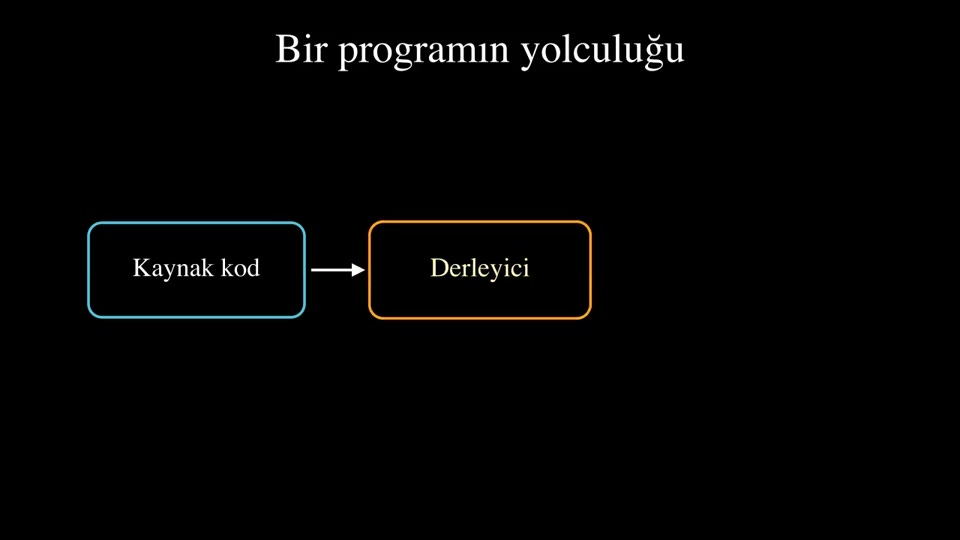
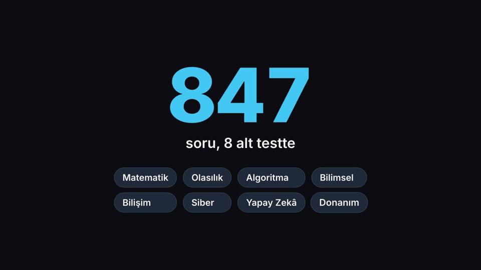

# Vitrin

Matematik ve algoritmaları görsel anlatan kısa animasyonlarım.

**▶ Siteden izle: https://erbaygursel.github.io/vitrin/**

| | Video | Araçlar |
|---|---|---|
|  | **YKDS Çalışma Defteri — tanıtım** (50 sn) | HyperFrames, GSAP, edge-tts |
|  | **İkili arama** (10 sn) | HyperFrames |
|  | **Bellek hiyerarşisi 3D** (72 sn) | three.js, HyperFrames |
|  | **Derleyici nasıl çalışır?** (19 sn) | Manim |
|  | **YKDS — hareketli grafik** (10 sn) | HyperFrames |
|  | **Bir simidin günü** (5 sn) | HyperFrames, GSAP |

Videoların hepsi kodla üretildi. Dosyalar `videolar/` klasöründe.
